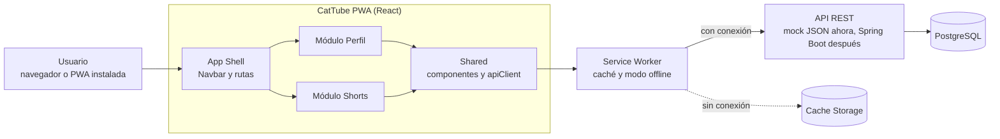
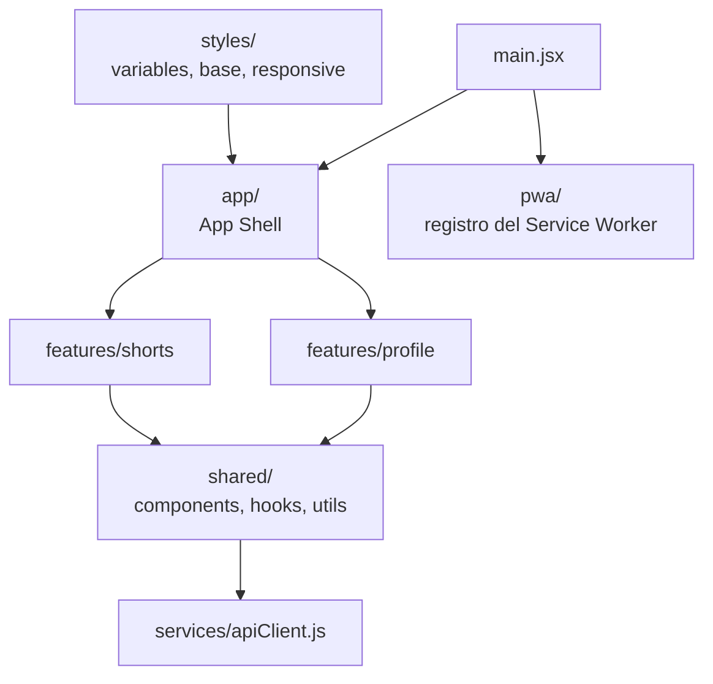
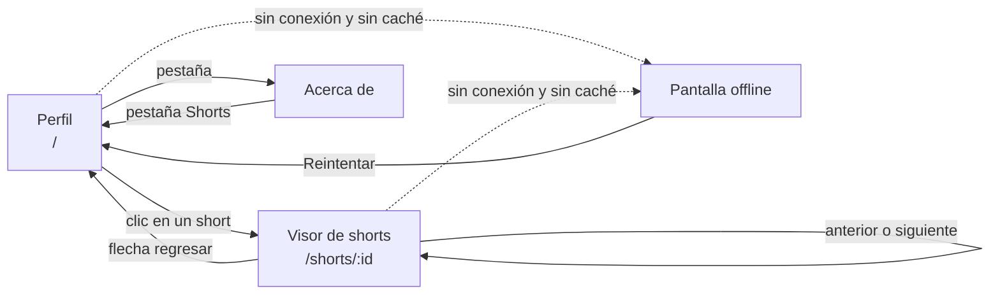
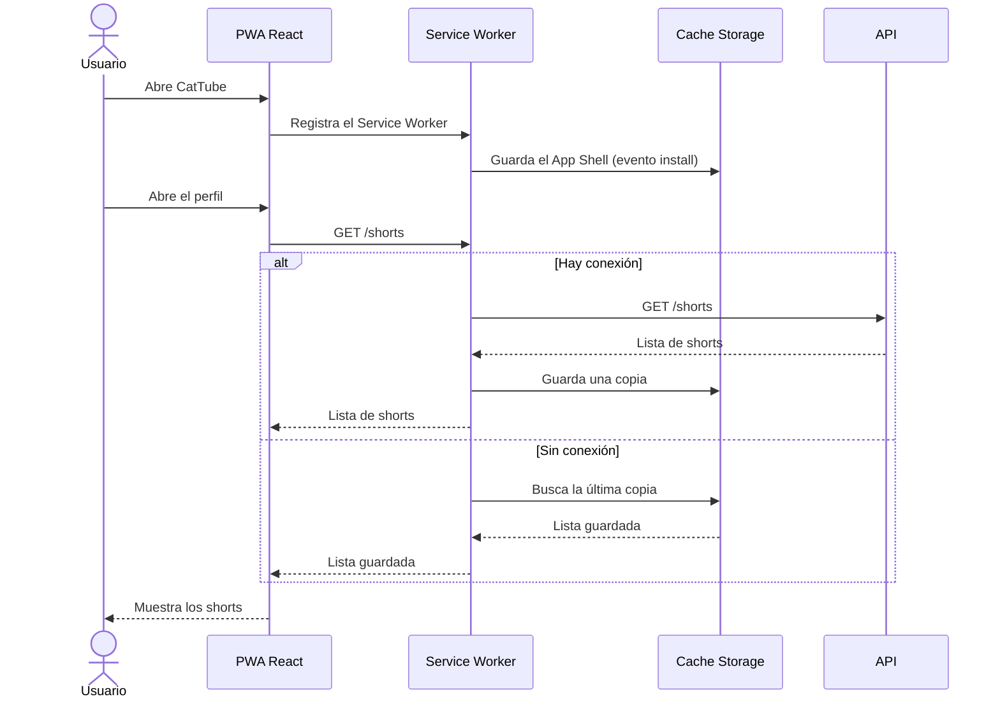
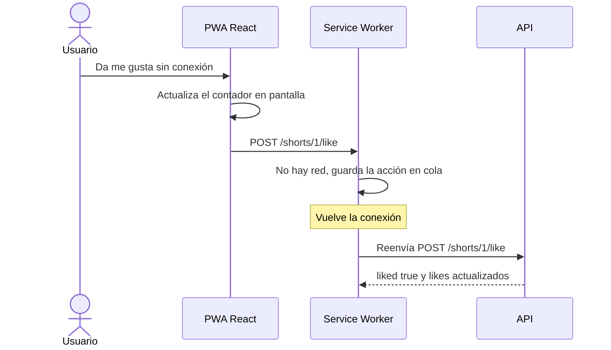

# Diagramas de CatTube

## 1. Arquitectura general

## 2. Organización del código (feature-based)

Regla de dependencias: los módulos de `features/` no se importan entre sí y solo usan `shared/`.

## 3. Flujo de navegación

## 4. Secuencia del Service Worker

Si no hay conexión y tampoco hay copia, el Service Worker responde con `offline.html`.

## 5. Me gusta sin conexión (Background Sync)

